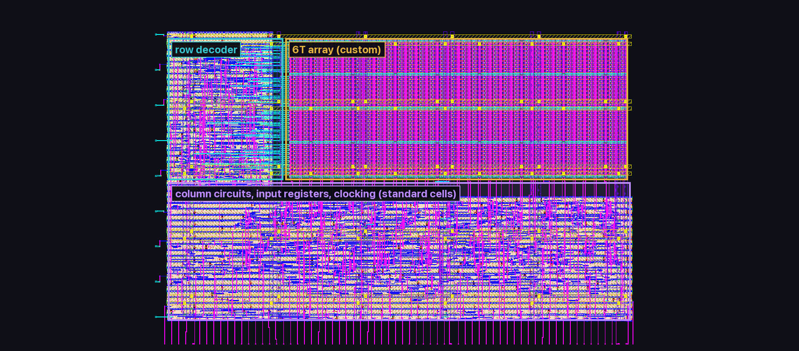
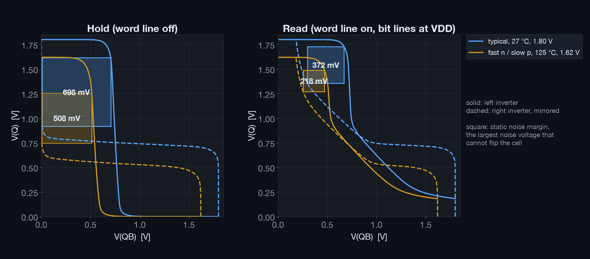
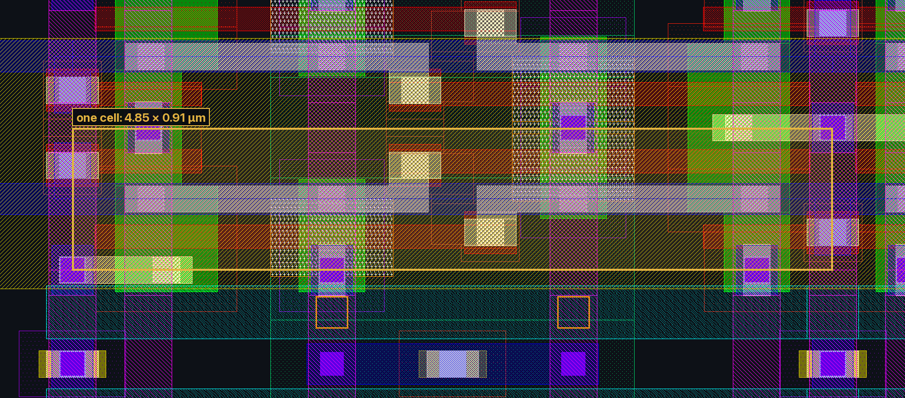
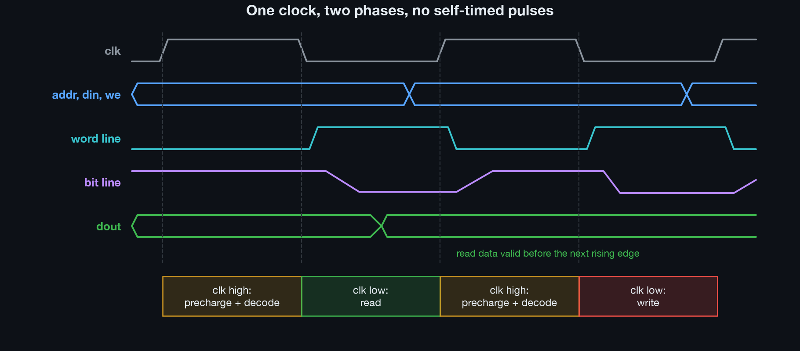

# A 6T SRAM macro for SKY130, from code to GDS

`sram_64x32` is a 64-word × 32-bit static RAM for the open-source SkyWater SKY130 process
(130 nm, 1.8 V). The bit-cell array is full-custom layout generated by Python; the periphery is
Verilog taken through an open RTL-to-GDS flow. Everything is checked with open tools: Magic,
KLayout, Netgen, ngspice, OpenROAD.



> **Status.** Sign-off clean and verified in post-layout SPICE at three corners.
> **Not fabricated**: every number below is from simulation or from checks on the layout.
> See [what is not covered](docs/verification.md#not-covered).

## Results

| | |
|---|---|
| Organisation | 64 words × 32 bits, single port, four byte-write enables |
| Bit cell | 6T, 4.85 × 0.91 µm (4.41 µm²), standard logic design rules |
| Macro | 225 × 156 µm (0.035 mm²), 19,741 transistors, power on metal 4, metal 5 free |
| Design rules | Magic (full deck): 0 · KLayout (PDK deck): 0 |
| LVS | transistor level, flat, no black boxes: match (18,248 devices, 7,230 nets) |
| Antenna / timing / power-grid checks | 0 violations |
| Cell stability | read noise margin ≥ 218 mV and write margin ≥ 342 mV over 11 PVT points; 1,000 Monte Carlo cells per condition, 0 failures |
| Post-layout SPICE | passes at tt 25 °C 1.80 V, ss 100 °C 1.60 V, ff −40 °C 1.95 V |
| Clock ↓ to data out | 2.5 ns typical, 5.0 ns slow corner |
| Clock period | passes at 6 ns typical and 11 ns slow corner in SPICE; specified 13.8 ns (72 MHz) |
| Supply current, reading at 50 MHz | 0.71 mA typical |

All tables: [docs/results.md](docs/results.md).

## How it works

**The cell.** Two cross-coupled inverters and two pass gates. The pull-down must beat the pass
gate (or a read flips the cell) and the pass gate must beat the pull-up (or a write fails). The
sizes were chosen from butterfly curves and write margins over process, voltage and temperature,
then checked with Monte Carlo mismatch.



**The layout.** The cell is drawn with the ordinary logic rules of the process, so the standard
DRC decks apply without waivers. It is a Python function: coordinates follow from the transistor
sizes and the rule constants, and because the cell is point-symmetric every shape is written
once and placed twice. Mirrored neighbours share their contacts.



**The periphery.** There is no sense amplifier and no self-timed pulse. The bit lines swing rail
to rail, a plain inverter senses them, and every internal event comes from one of the two clock
phases: precharge and decode while the clock is high, access while it is low. One standard
tri-state buffer per bit line precharges it, writes it, and keeps it high once the other line
has fallen, which makes the memory fully static.



More: [design notes](docs/design.md) · [data sheet](docs/datasheet.md) · [verification](docs/verification.md).

## What is in the repository

| path | content |
|---|---|
| [`release/`](release) | the macro: GDS, LEF, Liberty (3 corners), Verilog model, netlists, SDF, extracted SPICE |
| [`macro/`](macro) | the bit-cell array on its own: GDS, LEF, netlists |
| [`sram/`](sram) | Python: cell sizing (`bitcell.py`), layout generator (`cells.py`, `mag.py`), netlists, SPICE test benches (`slice.py`, `chipsim.py`), model handling, release and report builders |
| [`rtl/`](rtl) | the periphery (`sram_64x32.v`) |
| [`flow/`](flow) | LibreLane configuration, constraints, power-grid script |
| [`signoff/`](signoff) | DRC / LVS / extraction scripts for the array and for the complete memory |
| [`tb/`](tb) | self-checking test bench and the switch-level array model |
| [`example/`](example) | March C- self-test and an integration example that places the macro in a larger design |
| [`reports/`](reports) | the reports behind the numbers above |
| [`docs/`](docs) | data sheet, design notes, verification, results |
| [`video/`](video) | the code that renders the explainer video |

## Reproducing

Tools: Python ≥ 3.10 (`pip install -r requirements.txt`), ngspice ≥ 42 with KLU, the SKY130 PDK
(`sky130A`, for example through `ciel`), and the LibreLane container
(`ghcr.io/librelane/librelane:3.0.17`), which brings Magic, Netgen, KLayout, OpenROAD, Yosys and
Icarus Verilog. On macOS the container runs in a Lima VM; `signoff/vm.py` and `sram/paths.py`
hold the paths and can be overridden from the environment (`NGSPICE`, `PDK_ROOT`, `LIMACTL`,
`LIMA_HOME`, `LIMA_VM`; `TTS_PY` and `KOKORO_DIR` for the narration).

```bash
python -m sram.bitcell size          # cell sizing over PVT
python -m sram.bitcell corners       # chosen cell over PVT
python -m sram.bitcell mc            # Monte Carlo mismatch
python -m signoff.run_macro          # array: Magic DRC, KLayout DRC, LVS, GDS, LEF
sh tb/run_rtl.sh                     # logic simulation of the periphery (in the container)
flow/run.sh config.json              # RTL to GDS (in the VM)
python -m signoff.run_chip           # final GDS: flat extraction and transistor-level LVS
python -m sram.chipsim corners       # post-layout SPICE at the three corners
python -m sram.chipsim period        # clock-period sweep
python -m sram.chipsim interface     # inputs switching at the setup / hold limits
python -m sram.release               # assemble release/
python -m sram.report                # docs/results.md
python -m video.make render          # the video
```

## Limits

- No silicon. Clean sign-off and passing simulation make a design ready for a test chip, not proven.
- The Monte Carlo spread comes from the PDK's mismatch models.
- Post-layout SPICE uses extracted capacitance, not wire resistance (the largest wire RC is below 10 ps).
- No redundancy, no error correction, no column multiplexing: this is a small macro.
- The array generator takes `rows` and `cols`; the periphery is written for 64 × 32.

## Related work

[OpenRAM](https://github.com/VLSIDA/OpenRAM) is the established open-source memory compiler and
supports SKY130 with the foundry's SRAM cells, sense amplifiers and self-timed control. This
project is much smaller and makes different choices: a cell that stays within the logic design
rules, full-swing sensing, and a periphery that is plain standard-cell logic.

## Licence and credits

Apache-2.0 (see [LICENSE](LICENSE)). The layout in `release/` contains standard cells of
`sky130_fd_sc_hd` from the [SkyWater open-source PDK](https://github.com/google/skywater-pdk)
(Apache-2.0). Built with [Magic](http://opencircuitdesign.com/magic/),
[Netgen](http://opencircuitdesign.com/netgen/), [KLayout](https://www.klayout.de),
[ngspice](https://ngspice.sourceforge.io), [OpenROAD](https://theopenroadproject.org),
[Yosys](https://yosyshq.net/yosys/) and [LibreLane](https://github.com/librelane/librelane).
