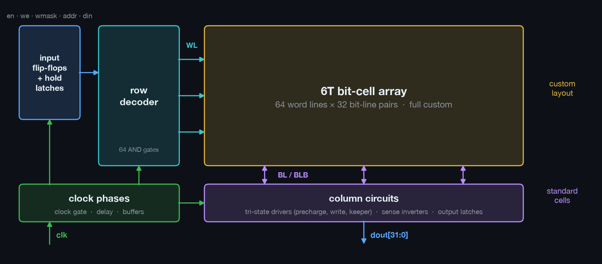
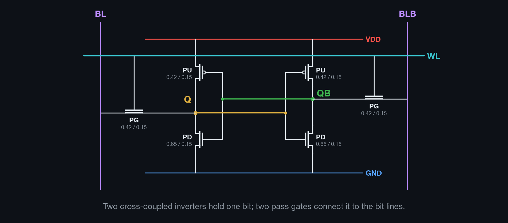
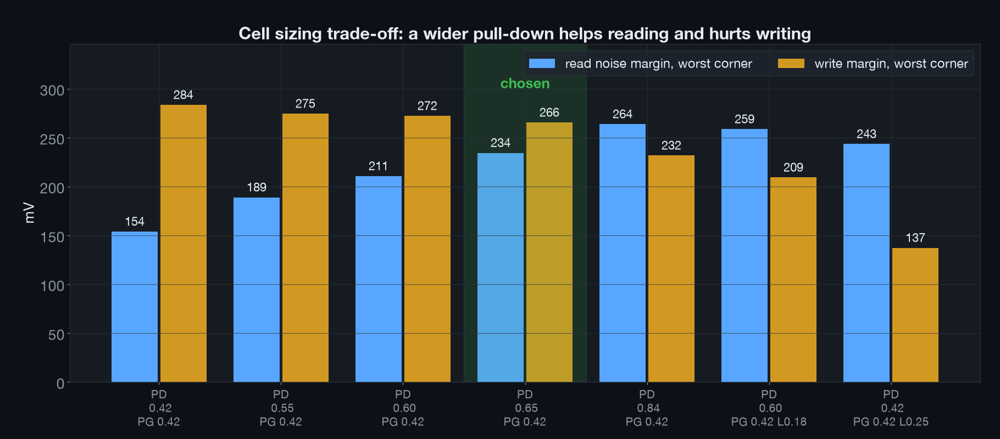
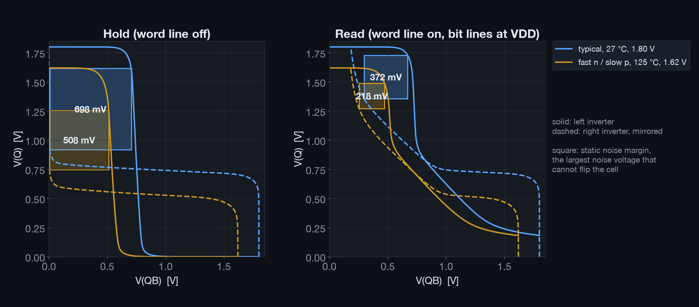
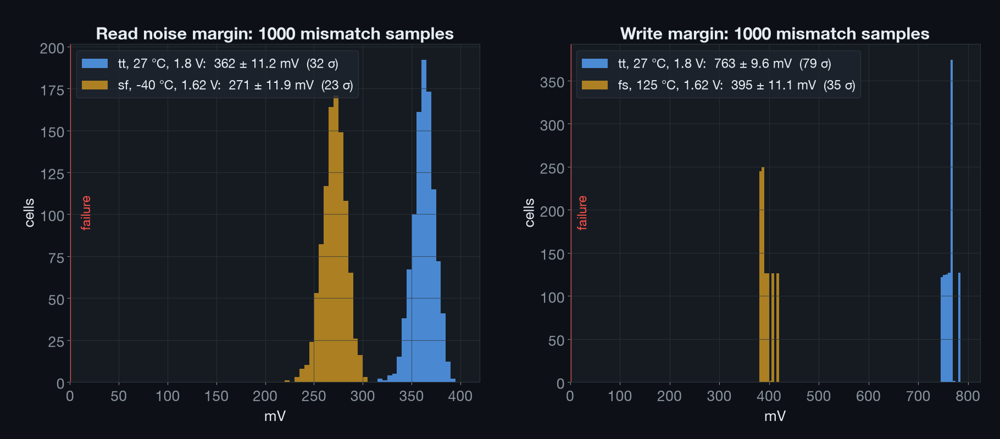
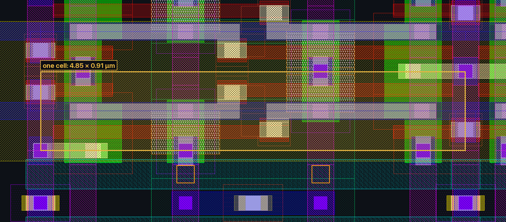
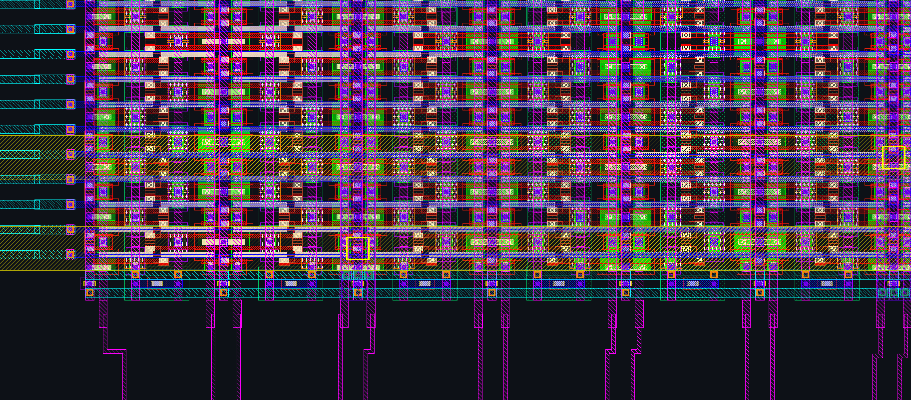
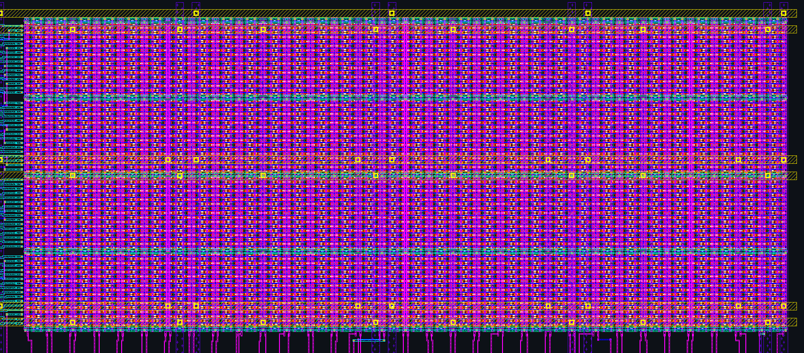
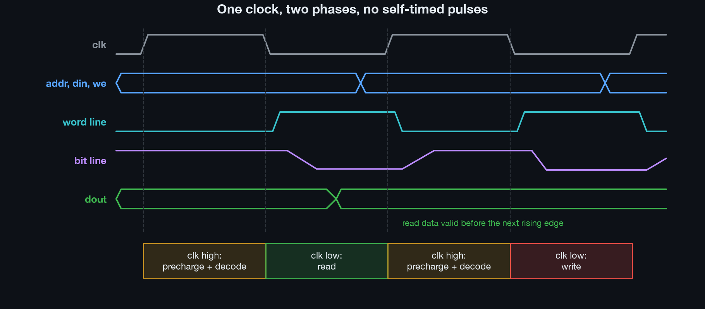
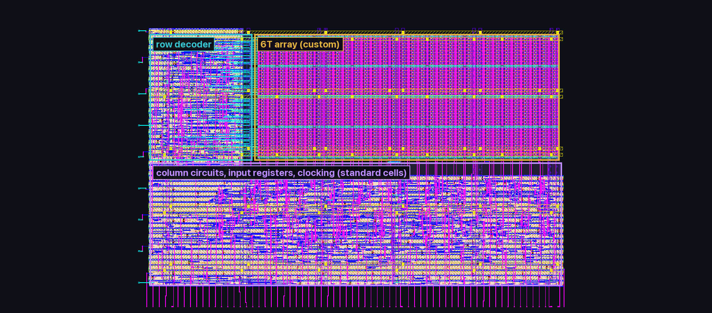

# Design notes

How the memory is built and why. Numbers are in [results.md](results.md); how each claim was
checked is in [verification.md](verification.md).

## 1. Overview

`sram_64x32` is a single-port synchronous SRAM with 64 words of 32 bits and four byte-write
enables, for the SkyWater SKY130 process at 1.8 V. It has two parts:

| part | how it is made | content |
|---|---|---|
| `sram_array_64x32` | full-custom layout, generated by Python (`sram/cells.py`) | 2,048 six-transistor cells, well taps, power straps, pins |
| periphery | Verilog (`rtl/sram_64x32.v`), synthesized, placed and routed with LibreLane | input registers, row decoder, word-line gates, bit-line drivers, sensing, output latches, clock phases |



The division follows one rule: custom layout only where it pays. The cell is repeated 2,048
times, so its area matters and it is drawn by hand-written code. Everything else is a few
hundred standard cells, where an automatic flow is faster, safer and checked by the same
sign-off tools as any digital block.

## 2. The bit cell



### Sizing

A 6T cell has to satisfy two opposite conditions:

- **Read stability.** During a read both bit lines are at VDD and the word line is on. The pass
  gate lifts the node that stores 0. The pull-down must be stronger than the pass gate, or the
  cell flips.
- **Writability.** During a write one bit line is at 0 V. The pass gate must pull the node that
  stores 1 below the trip point of the other inverter, against the pull-up.

`python -m sram.bitcell size` sweeps the pull-down width (and two variants with a longer pass
gate) over eleven process / voltage / temperature points and reports the static noise margins
(butterfly curves) and the write margins.



The chosen cell:

| device | W / L (µm) | model |
|---|---|---|
| pull-down | 0.65 / 0.15 | `sky130_fd_pr__nfet_01v8` |
| pass gate | 0.42 / 0.15 | `sky130_fd_pr__nfet_01v8` |
| pull-up | 0.42 / 0.15 | `sky130_fd_pr__pfet_01v8_hvt` |

0.42 µm is the minimum transistor width of the logic rules, so the cell ratio is set by widening
the pull-down. The high-threshold pull-up is the same device the standard cells use; compared
with the regular p-channel device it lowers the hot-corner leakage of a cell by about a factor
of ten and makes the cell easier to write, at the cost of roughly 15 mV of read margin.



Local mismatch is checked with the `*_mm` model corners: 1,000 cells per condition, each
transistor with its own random parameters (`python -m sram.bitcell mc`).



### Layout



The cell uses the "thin cell" arrangement: an n-type strip on each side with a pull-down and a
pass gate, two p-type strips in a shared n-well in the middle, and two horizontal poly levels.
One poly piece is the common gate of a pull-down and a pull-up.

The cell is drawn with the **logic design rules** of SKY130. Foundry SRAM cells use a separate,
tighter rule set (butted contacts, smaller transistors), which only applies inside cells that
the foundry has qualified. Using the logic rules means the stock DRC decks apply without any
waiver. It also fixes the shape of the cell:

- Without butted contacts, each cross-coupling connection needs its own poly contact. A poly
  contact must stay 0.19 µm away from n diffusion and 0.235 µm away from p diffusion, and its
  poly landing pad must keep 0.21 µm to other poly. The two contacts therefore sit between the
  two p strips, and that gap (1.12 µm) is what makes the cell wide.
- The drain of the 0.65 µm pull-down needs 0.25 µm of diffusion past the gate before the strip
  can narrow to the 0.42 µm pass gate, and the pass gate must stay 0.075 µm away from that
  step. This sets the distance between the two poly levels (0.48 µm) and the height of the cell.

The result is 4.85 × 0.91 µm = 4.41 µm², a little more than twice the foundry cell.

Layers: local interconnect for the storage nodes, metal 1 for the word line (horizontal),
metal 2 for the bit lines, VDD and GND (vertical). Neighbours are mirrored in x and y, so bit-line
contacts, power contacts and the word-line poly contact lie on the cell boundary and are shared.

The cell is one Python function. All coordinates are derived from the transistor sizes and the
rule constants, and because the cell is point-symmetric every shape is written once and placed
twice:

```python
def diff(X, Y):
    c.rect("ndiff", X(g.xn), Y(-140), X(g.xn_w), Y(g.y_jog))       # wide: pull-down + GND contact
    c.rect("ndiff", X(g.xn), Y(g.y_jog), X(g.xn_n), Y(H + 140))    # narrow: pass gate + bit-line contact
    c.rect("pdiff", X(g.xp1), Y(-140), X(g.xp1r), Y(g.y_mid + 125))
both(diff)
```

The output is a Magic `.mag` file. Magic composes paint the way a layout editor does (poly over
diffusion becomes a transistor, contacts on adjacent layers stack) and derives the implant and
contact-cut layers when it writes GDS, so those are correct by construction.

## 3. The array macro



- 64 rows × 32 columns, built from a 2 × 2 "quad" of mirrored cells.
- A **strap row** every 16 rows and at both ends: an n-well tap and a substrate tap in every
  column (latch-up rules require a tap within 15 µm of every diffusion), and two horizontal
  metal 3 rails that collect the vertical metal 2 power lines.
- The metal 3 rails are the **power pins** of the macro. The power grid of the surrounding
  design runs its vertical metal 4 straps across the array and drops vias onto them.
- **Word-line pins** on the left edge on metal 3, **bit-line pins** on the bottom edge on metal 2.



Extracted loads: about 85 fF on a word line (64 pass-gate gates plus wire), about 35 fF on a bit
line (19 fF wire plus the 64 switched-off pass gates).

## 4. The periphery

### No sense amplifier, no self-timed pulse

A classic SRAM stops the bit-line swing at 100 to 200 mV and fires a sense amplifier with a
self-timed pulse. That is fast and saves power on long bit lines, and it is where most of the
analog risk of a memory lives: the pulse must come late enough at every corner and for every
mismatched cell.

With 64 cells on a 35 fF bit line and a read current above 50 µA at every corner, a full swing
takes about a nanosecond. So this memory lets the bit lines swing rail to rail and senses each
of them with a plain inverter. Every internal event is derived from one of the two clock phases:



| phase | what happens |
|---|---|
| rising clock edge | `en`, `we`, `wmask`, `addr`, `din` are sampled by flip-flops |
| clock high | bit lines are precharged to VDD, the address decodes |
| clock low (if enabled) | one word line is on; the cell discharges one bit line (read) or a driver does (write) |
| next rising edge | `dout` is valid; it changes shortly after the falling edge and then holds |

If a phase turns out too short on silicon, the fix is a slower clock. No delay has to match
another delay for the memory to function.

### One tri-state buffer per bit line

Each bit line is driven by one standard tri-state buffer (`ebufn_2`) that does three jobs:

| condition | driver | purpose |
|---|---|---|
| clock high | drives 1 | precharge |
| clock low, this line is being written | drives 0 | write |
| clock low, the *other* line of the pair has fallen | drives 1 | keeper |
| otherwise | off | the selected cell discharges the line |

The keeper makes the memory fully static. During a read the high bit line would otherwise float
for the whole low phase and slowly leak down; with the keeper it is actively held as soon as the
low side has been detected, so the clock can be stopped in either phase.

The sense inverter outputs set or reset a NAND latch per bit, gated by a read enable, so `dout`
changes only as the result of a read and holds through writes, disabled cycles and precharge.

### Avoiding the one race

The dangerous moment is the rising clock edge. The flip-flops take new values about 0.3 ns after
the edge, while the phase clock that enables the word line and the write drivers of the
*previous* access switches off about 0.6 ns after the edge (clock buffer, inverter, clock gate,
buffer). Without protection a new address could reach the decoder while a word line and a write
driver are still on, and write into the wrong word.

Hold latches between the flip-flops and the rest of the logic prevent this. They are transparent
only while a delayed copy of the phase clock is low, so they open roughly 1 ns after the
previous access has ended, and they close long after the flip-flops have stopped changing. The
margin is a ratio of gate delays, so it tracks over corners (0.5 to 1.6 ns in SPICE).

The phase clock itself comes from an integrated clock-gate cell, so it cannot glitch when `en`
changes.

### Cells that are placed by hand in the RTL

Synthesis is free to restructure logic, which is fine for the decoder and unacceptable where a
glitch would turn on a word line. Those cells are instantiated explicitly in the Verilog
(`keep_*`): the clock buffer, inverter and clock gate, the phase-clock buffers and the delay
cells, the hold latches, the word-line AND gates, the write and read enables, the tri-state
drivers, the sense inverters and the output latches.

The phase clock is distributed by three hand-placed buffers instead of clock-tree synthesis. The
clock-tree tool follows a clock through every gate it reaches; here that path continues through
the word-line gates into the array and through the bit-line drivers onto the bit lines, which
the tool cannot handle. Automatic clock-tree synthesis is therefore switched off, and the
resulting clock arrival times are checked by static timing analysis and by SPICE.

## 5. Physical implementation



LibreLane 3.0.17 (Yosys, OpenROAD, Magic, KLayout, Netgen) places the array as a hard macro in
the upper right of a 225 × 156 µm die and puts the standard cells below it (column circuits) and
to its left (row decoder). The floorplan is chosen so that no standard-cell row is cut off from
the power grid by the macro. The bit-line nets are marked "don't touch" so that the timing
repair step cannot insert a buffer into a bidirectional analog-ish net.

## 6. What I would do next

- A test chip. Everything here is simulation and sign-off.
- Column multiplexing and more rows for larger capacities; the array generator already takes
  `rows` and `cols`, the periphery does not yet.
- Extraction of wire resistance inside the array, and electromigration / dynamic IR analysis.
- Redundancy or ECC, which any memory of useful size needs.
